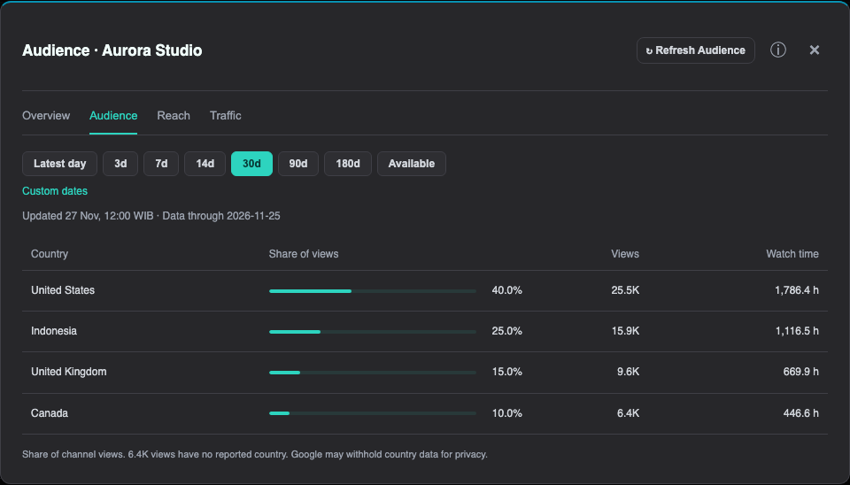
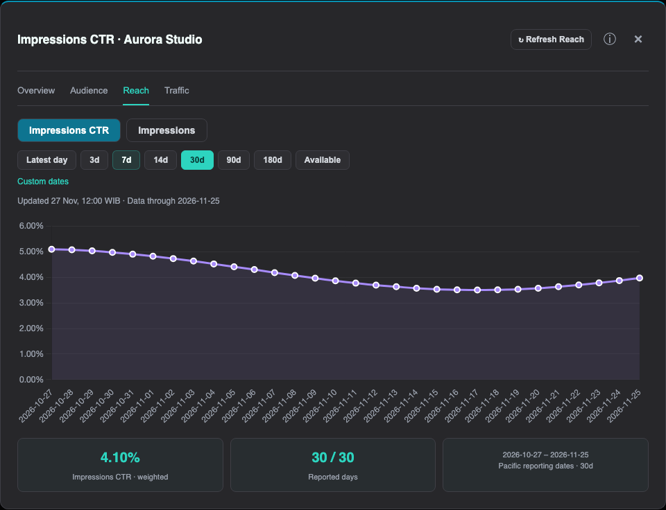
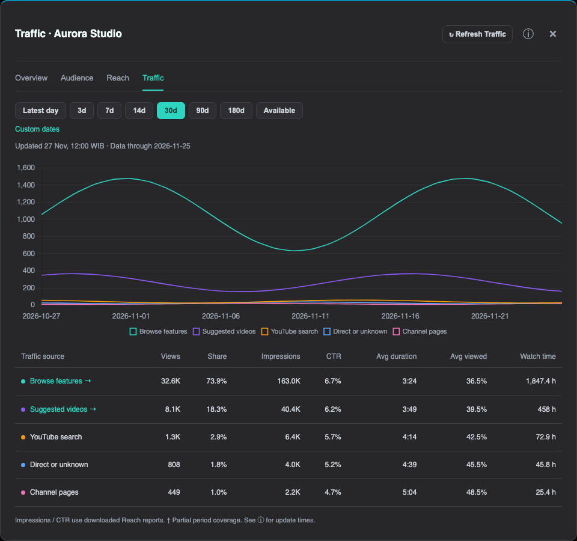
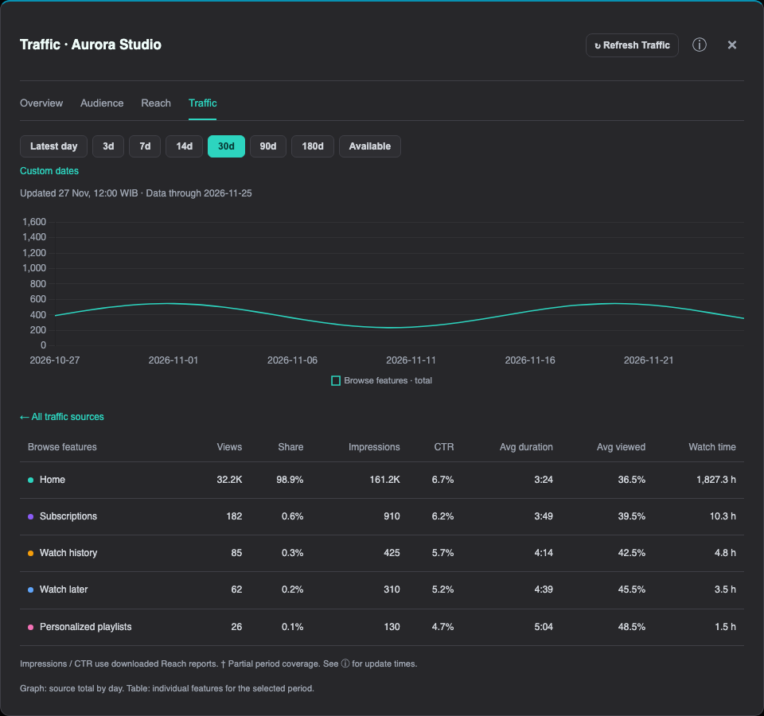
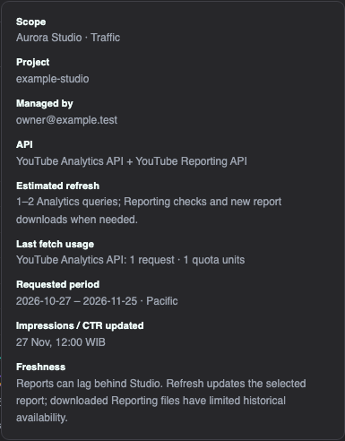
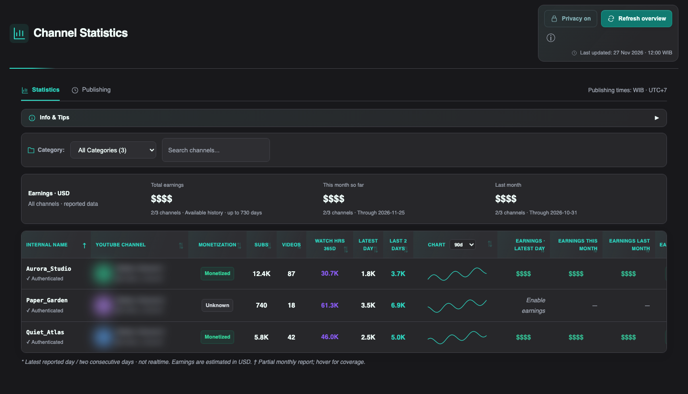
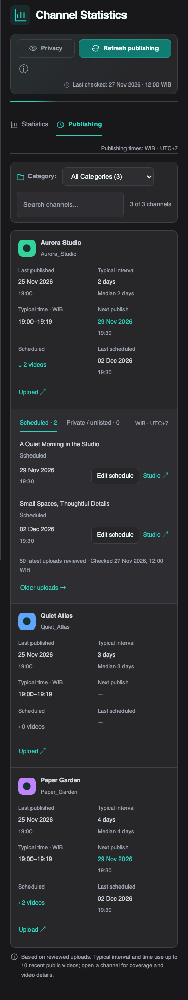

# Native UI reference

Open these images when creating or revising a Muse dashboard, and supply the
images plus the relevant written/data brief to the artifact builder. The user
should not need to take screenshots for ordinary setup. These are captures of
the native templates with synthetic channels and metrics, not a public demo or
live account evidence. Do not copy sample identities, amounts or worker states
into an instance assignment or real snapshot.

## Statistics


Preserve the table-first density, restrained teal accents, aligned numbers,
category/search controls and chart cells. The Chart header has a shared interval
selector with a 90d default; each row shows a cached views sparkline. The modal
retains its separate period controls and 30d default. The current header groups Privacy,
tab-specific Refresh and its retrieval time at the right. The app sidebar is
cropped out; a Muse artifact does not need to reproduce unrelated app navigation.
Keep unavailable revenue distinct from zero.


Use a real chart dialog with period and metric controls. Hover/touch selects the
nearest reporting date across the plot. Dates, units and permission states follow
the data contract; an attractive screenshot alone is not proof of working charts.





Load Overview, Audience, Reach and Traffic details on demand with their own dated caches.
Keep zero, withheld countries, pending Reach setup and API-disabled states distinct.







Keep the table/graph relationship, explicit refresh scope and per-report dates.
The Browse table is an aggregate; its graph shows the valid total-source daily
trend, not invented per-feature daily values. API details are progressively
disclosed. Real unavailable/partial Reach states follow the data contract.


Keep the modal, period controls and summary cards inside the viewport. Sparklines
stay inside their column; the wide channel table scrolls within its container.



Use the native $$$$ monetary placeholder and mask identity in the dialog too.
The written privacy contract also covers open charts, summaries and tooltips.

## Publishing


Preserve Statistics / Publishing as separate tabs, the shared filters, observed
cadence/time columns and expandable video lists. Follow
[Publishing behavior](publishing.md), including its separate refresh/cache.
Native write buttons are visible in this source capture; a reporting-only Muse
assignment does not gain permission to edit schedules or upload from this image.
Offer those actions only when an assigned, implemented host route supports them.



Adapt the component to the artifact viewport. Keep table overflow inside its
scrolling region or use the native stacked presentation; chart/dialog controls
must remain reachable. Do not copy an existing app-shell overflow into Muse.

## Keep the reference current

The [capture manifest](ui/source.json) records the source commit and hashes of
the relevant native files. Compare it with the assigned checkout before a new
build or source-driven UI update. A different commit alone is not a UI change:
inspect the page/partials/CSS/JS diff. Current source and the user's explicit
choices determine behavior; these images document a reviewed baseline.

Read these together:

- src/templates/channel_statistics.html and src/templates/base.html for page
  structure, theme tokens, table/chart behavior and final style overrides.
- src/templates/partials/channel_publishing.html,
  src/static/css/channel_publishing.css and src/static/js/channel_publishing.js
  for the second tab and the shared header. Read referenced helpers as needed.
- src/channel_analytics.py, src/channel_publishing.py, the matching src/app.py
  handlers and docs/channel-publishing.md for real data and action contracts.
- src/channel_insights.py, src/channel_reach.py, src/static/js/channel_insights.js
  and src/static/css/channel_insights.css for lazy detail requests, cache behavior,
  thumbnail Reach and modal layout.

When a UI-affecting source update is assigned, update the same artifact and
inspect desktop, a narrow viewport, chart/Privacy and Publishing details. Keep
the existing connections, data and preferred chat. If the host cannot view
images, use the source plus the written composition above and report that
visual verification is pending; do not make a user's screenshot the default
prerequisite or claim an unseen viewer was verified.

## Rebuild the captures

Maintainers can run scripts/capture_ui_reference.py from this skill using an
assigned YtFusion checkout, Jinja2, Playwright/Chromium and a local copy of the
Chart.js 4.4.0 UMD file used by that checkout:

```bash
python scripts/capture_ui_reference.py --source /path/to/Yt_FusionX --chart-js /path/to/chart.umd.min.js
```

Run from the skill folder, or use the script's absolute path. An optional
--browser argument selects a locally installed Chromium/Chrome. The default
output is references/ui; --output selects another folder. Obtain dependencies
through the host's supported installation process only when needed. This is
a reference-maintenance tool, not a prerequisite for every Muse setup.

The script renders current templates with deterministic fictional data in an
isolated browser, intercepts every page request and rejects write requests.
It does not import src/app.py, start a backend, read account/config files, call
Google, or require a connected Mac. Inspect all generated images before replacing
the reviewed references. Do not change the running application to create them.
