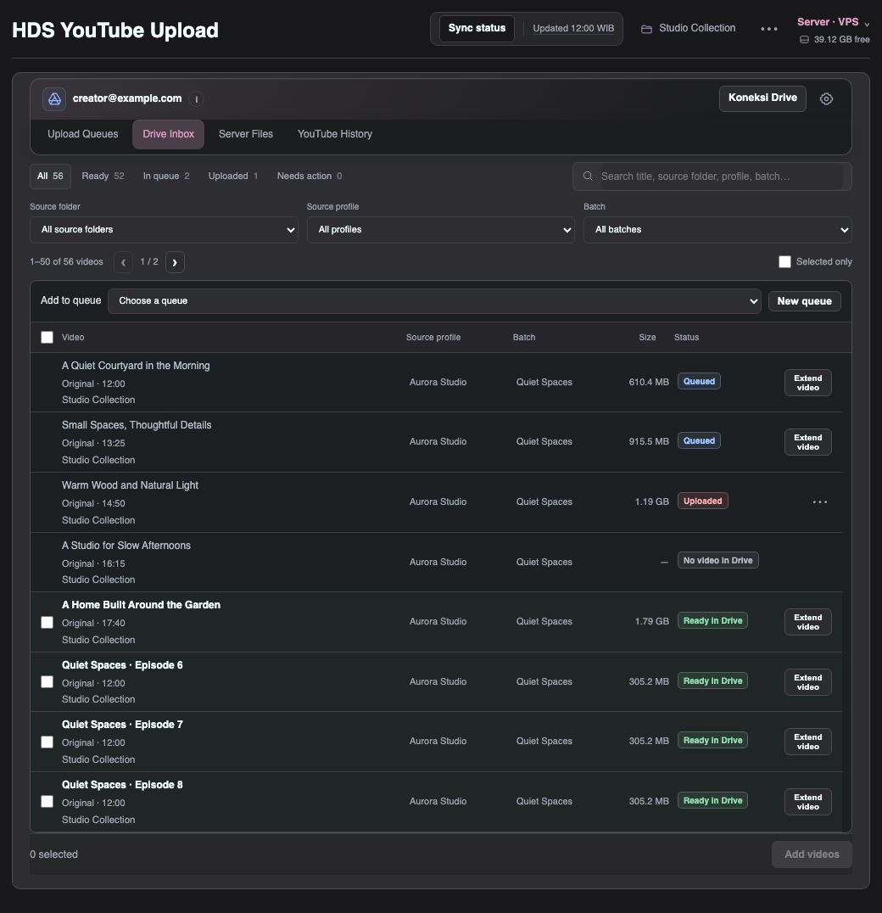
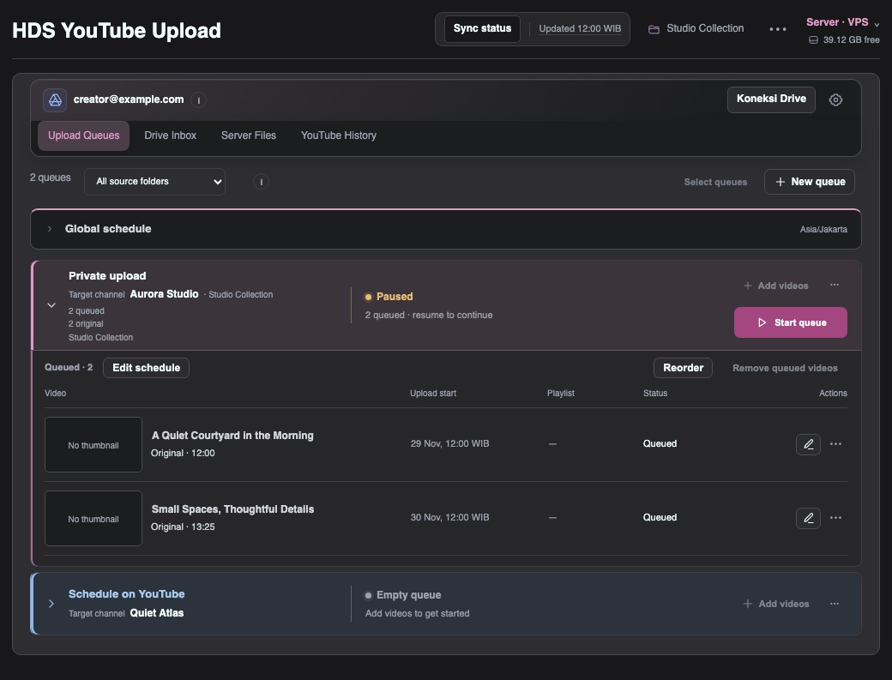
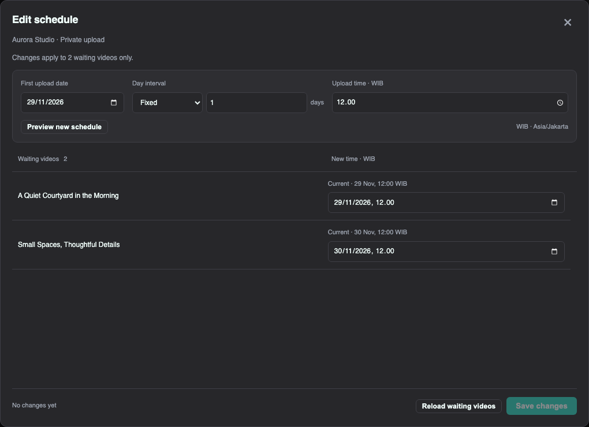
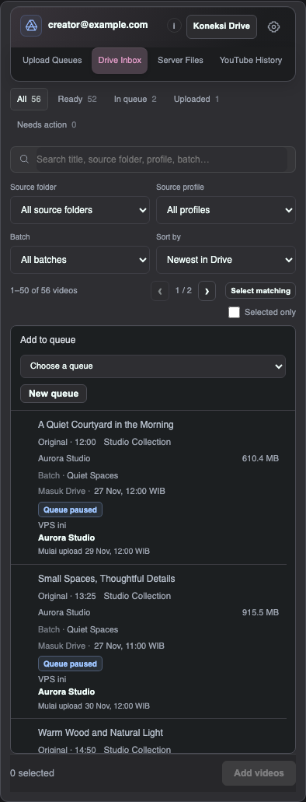
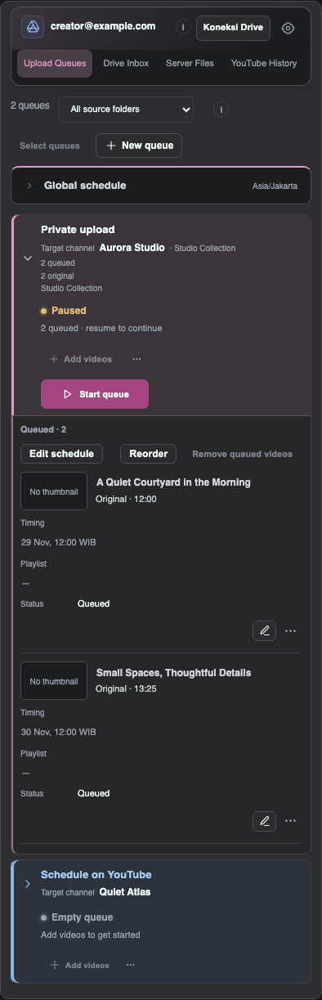

# Native YT Upload visual reference

Open these captures and give them to the Space builder with the
[workspace/data-action contract](workspace.md). They render the maintained native
template/assets with fictional accounts and packages, without a running backend
or Google requests. The fixtures illustrate composition, not live upload proof.

## Reuse the current native CSS

Build from the assigned YtFusion checkout's actual styles and template structure.
Read `src/templates/base.html` for native theme/font/fallback/common controls,
then `src/templates/yt_upload.html` inline styles and its linked
`src/static/css/yt_drive_workspace.css`, `yt_drive_inbox.css`,
`yt_channel_queue.css`, `yt_queue_schedule.css` and relevant final overrides.
Follow template load order; inspect other includes when the shown surface uses
them. Import/copy current styles as artifact build inputs, transfer necessary
inline/theme rules and use the corresponding native classes/structure in host
components. Scope global selectors and adapt native role/body selectors to the
artifact root. Preserve the Muse shell and existing storage/worker bindings.

A VM-local `/static` URL cannot serve the artifact's stylesheet. Use supported
builder files or exact CSS text with source paths/revision. These are generated
artifact assets: regenerate from the updated app on an assigned UI update, and
do not maintain another stylesheet in this skill repo. Screenshots verify the
result rather than stand in for the actual source styles.

Keep native font/fallback, text size/weight/line-height, neutral panels, restrained
source/action colors, row density, control shapes, spacing and responsive rules.
Verify the font actually available; avoid a different decorative heading font
or new pill/card system. Compare same-size desktop/narrow screenshots and
computed styles for header/tabs, filters, Inbox rows, status/timing, channel
queue cards and detail panels. Derive values from current source, not a fixed
second token table. Check long titles, empty/partial data and draft/held states.
Working queue actions alone do not establish visual parity; report actual host
limitations and distinguish source, installed skill and delivered workspace.

A visual-only update preserves Inbox/queue/History snapshots, source/job IDs,
receipts, draft/held acknowledgement, selection and execution flags. It does not
authorize a Drive scan, media transfer, draft mutation, scheduling or native-app
startup merely to populate or test the design.

Keep the native density: compact title/actions, workspace navigation, status
filters, source facets and aligned rows. Keep the page range and previous/next
controls beside the result count. Show **Newest in Drive** as the default
sort in the existing filter row. Show the Drive arrival timestamp in a sortable
**Masuk Drive** column, with a labeled row on narrow screens. Put thumbnail/title
and source labels before file size/status. For queued packages, show the
worker and YouTube destination in Status, plus the upload start and scheduled
publish time in WIB when available. Use a restrained Drive accent for source actions and
YouTube/VPS accent for queue actions; avoid large summary cards or long setup
explanations. UI labels are English. Muse uses **Drive Inbox / Upload Queue /
History**; its own shell replaces the unrelated YtFusion sidebar.

Retain per-channel/mode groups, destination clarity, next timing and expandable
video details. A source profile is not the destination. Native action buttons
are design references: enable only actions the assigned executor implements.
Draft/held state and the actual worker acknowledgement must stay visible.

Use this layout when timing is implemented: compact field groups, preview and
clear save action. For the first held-queue proof, hide unused timing controls
rather than imitating an active native scheduler. Retain explicit settings in
the durable job; saving them alone does not authorize an upload.

Wrap filters, keep video identity/status readable and actions reachable. Prefer
the native stacked treatment or a contained scroll region over page overflow.
Do not reproduce unrelated navigation or a native layout defect in a Muse Space.
The narrow captures crop the native app-shell header; Muse supplies its own
compact header. The native Inbox currently uses text rows; a declared thumbnail
preview may be added without replacing the compact title/source/status layout.

## Current source map

Read the [capture manifest](ui/source.json) and compare its relevant file hashes
with the assigned app. A new commit alone does not invalidate a screenshot.
Inspect changed templates/assets and refresh the visual baseline if needed.

- `src/templates/yt_upload.html`: main composition, editor/defaults, Inbox and
  queue navigation, settings dialogs and referenced final scripts/styles.
- `src/static/js/yt_drive_inbox.js`, `yt_drive_jobs.js`, `hds_upload_sync.js`:
  source facets, package/status/selection rendering and refresh contract.
- `src/static/js/yt_channel_queue.js`, `yt_queue_schedule.js`,
  `yt_upload_clock.js`, `yt_queue_order.js`: persistent groups, timing, ordering
  and controls. Read corresponding CSS plus progress/completed helpers as needed.
- `src/app.py`: inspect only the relevant `/api/hds/yt_upload/drive_inbox`,
  `channel_queue`, `status_refresh`, History/receipt and worker handlers. The
  native authenticated routes are not automatically available to a Space.
- `src/hds_upload_dispatch.py`, `hds_youtube_upload.py`, `hds_drive_upload_bridge.py`
  and `docs/yt-upload-channel-queue-plan.md`: backend behavior reference. Reuse
  appropriate installed pure identity/format helpers; do not copy Private engines
  to this repo or fabricate native state for an independent executor.

## Refresh captures

Maintainers run `scripts/capture_ui_reference.py --source /path/to/Yt_FusionX`
from this skill, using installed Jinja2, Playwright and Chromium/Chrome. Optional
`--browser` chooses an existing executable; `--output` selects another directory.
It intercepts all network requests, blocks operational writes and uses a temporary
synthetic queue. No live app, credentials, collection or account is loaded. Review
every resulting PNG before updating the manifest. This helper is reference
maintenance, not a prerequisite for each user setup.
